

  <picture>
    <source media="(max-width: 600px)" srcset="assets/hero-narrow.svg">
    
  </picture>

  <picture>
    <source media="(max-width: 600px)" srcset="assets/whoami-narrow.svg">
    
  </picture>

  <a href="https://phosphor.zanoski.com"></a>
  <a href="https://hyprtile.zanoski.com"></a>
  <a href="https://firewall.zanoski.com"></a>
  <a href="https://run-skellybon-run.zanoski.com"></a>
  <a href="https://survive.zanoski.com"></a>
  <a href="https://survival-guide.zanoski.com"></a>
  <a href="https://gitlab.com/Zanoshky"></a>
  <a href="https://zanoski.com"></a>

  <b>On Google Play</b>  
  <b>Firewall</b> blocks a domain in every app, no root needed. Phones and Android TV. <a href="https://play.google.com/store/apps/details?id=com.zanoshky.firewall">Google Play</a> · <a href="https://zanoshky.github.io/firewall-app/">Guide</a> 
  <b>Hush Hour</b> plays sleep sounds and white noise, offline. <a href="https://play.google.com/store/apps/details?id=com.zanoshky.hushhour">Google Play</a> · <a href="https://zanoshky.github.io/hush-hour-app/">Guide</a> 
  <b>Pure Peek</b> opens any file offline: photos, PDF, tables, code. <a href="https://play.google.com/store/apps/details?id=com.zanoshky.purepeek">Google Play</a> · <a href="https://zanoshky.github.io/pure-peek-app/">Guide</a> 
  <b>Neat Nest</b> is a text editor that views, tidies and compares JSON. <a href="https://play.google.com/store/apps/details?id=com.zanoshky.neatnest">Google Play</a> · <a href="https://zanoshky.github.io/neat-nest-app/">Guide</a> 
  <b>Fileglow</b> is a file manager that wears your launcher's theme. <a href="https://play.google.com/store/apps/details?id=com.zanoshky.fileglow">Google Play</a> · <a href="https://zanoshky.github.io/fileglow-app/">Guide</a> 
  <b>First Flow</b> is gentle yoga for beginners, 20 poses in about 20 minutes. <a href="https://play.google.com/store/apps/details?id=com.zanoshky.firstflow">Google Play</a> · <a href="https://zanoshky.github.io/first-flow-app/">Guide</a> 
  <b>Breath Switch</b> guides nostril breathing for calm, sleep or focus. <a href="https://play.google.com/store/apps/details?id=com.zanoshky.breathswitch">Google Play</a> · <a href="https://zanoshky.github.io/breath-switch-app/">Guide</a> 
  <b>Keyglow</b> is a keyboard that takes its look from Hyprtile or Phosphor. <a href="https://play.google.com/store/apps/details?id=com.zanoshky.keyglow">Google Play</a> · <a href="https://zanoshky.github.io/keyglow-keyboard/">Guide</a> 
  <b>Hyprtile</b> turns your home screen into a tiling desktop. <a href="https://play.google.com/store/apps/details?id=com.zanoshky.hyprtile">Google Play</a> · <a href="https://zanoshky.github.io/hyprtile-launcher/">Guide</a> 
  <b>Phosphor</b> is a terminal home and lock screen. <a href="https://play.google.com/store/apps/details?id=com.zanoshky.phosphor">Google Play</a> · <a href="https://zanoshky.github.io/phosphor-launcher/">Guide</a>

  Most of my code lives on <a href="https://gitlab.com/Zanoshky">GitLab</a>. Questions about an app: <a href="mailto:support@zanoski.com">support@zanoski.com</a>. More at <a href="https://zanoski.com">zanoski.com</a>.

  <picture>
    <source media="(max-width: 600px)" srcset="assets/sky-narrow.svg">
    
  </picture>

  <picture>
    <source media="(max-width: 600px)" srcset="assets/contact-narrow.svg">
    
  </picture>

  
  <a href="https://gitlab.com/Zanoshky"></a>
  
  

