

  <picture>
    <source media="(max-width: 600px)" srcset="assets/hero-narrow.svg">
    
  </picture>

  <picture>
    <source media="(max-width: 600px)" srcset="assets/whoami-narrow.svg">
    
  </picture>

  <a href="https://phosphor.zanoski.com"></a>
  <a href="https://hyprtile.zanoski.com"></a>
  <a href="https://firewall.zanoski.com"></a>
  <a href="https://run-skellybon-run.zanoski.com"></a>
  <a href="https://survive.zanoski.com"></a>
  <a href="https://survival-guide.zanoski.com"></a>
  <a href="https://gitlab.com/Zanoshky"></a>
  <a href="https://zanoski.com"></a>

  Most of my code lives on <a href="https://gitlab.com/Zanoshky">GitLab</a>. Firewall is open source <a href="https://github.com/Zanoshky/android-firewall">right here</a>, and it is on <a href="https://play.google.com/store/apps/details?id=com.zanoshky.firewall">Google Play</a> with <a href="https://play.google.com/store/apps/details?id=com.zanoshky.runskellybonrun">Run Skellybon Run</a>.

  <picture>
    <source media="(max-width: 600px)" srcset="assets/sky-narrow.svg">
    
  </picture>

  <picture>
    <source media="(max-width: 600px)" srcset="assets/contact-narrow.svg">
    
  </picture>

  
  <a href="https://gitlab.com/Zanoshky"></a>
  
  

